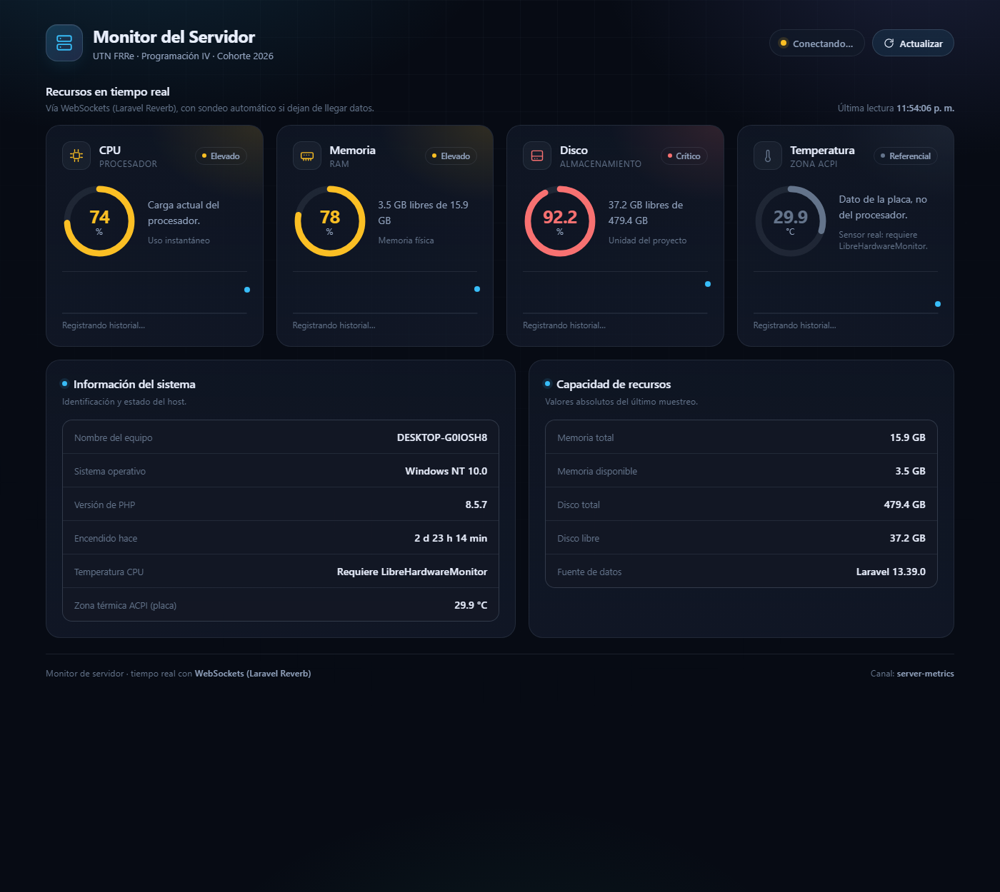
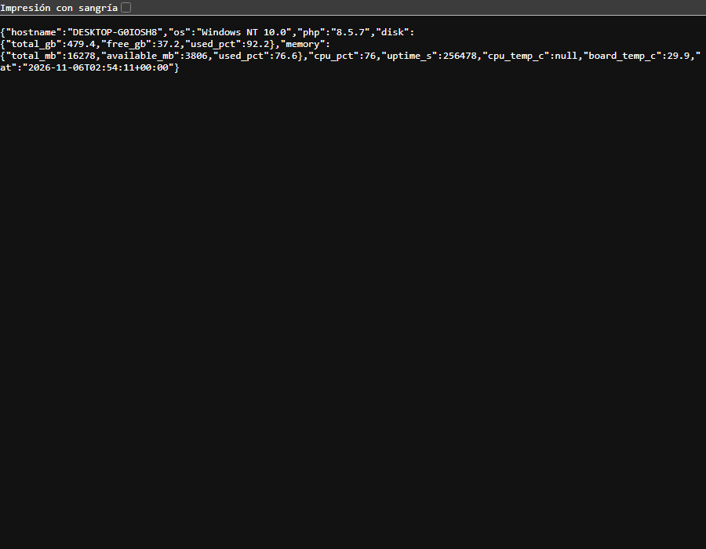

# Monitor del Servidor

Panel web que muestra el estado del equipo donde corre la aplicación: CPU, memoria, disco, tiempo encendido y temperatura.

Proyecto de **Programación IV**, UTN FRRe, cohorte 2026.

## Qué incluye

- **Servicio `ServerMetrics`:** lee los datos del sistema operativo con PHP y PowerShell (CIM/WMI).
- **Vista web** (`/servidor`): medidores de CPU, memoria, disco y temperatura, con estados e historial de la sesión.
- **API REST** (`/api/metrics`): las mismas métricas en JSON.
- **Actualización automática:** la página recibe los datos por WebSockets (Laravel Reverb). Si pasan 10 segundos sin datos, consulta `/api/metrics` cada 5 segundos (polling) y lo indica como "Sondeo cada 5 s".
- **API GraphQL** (`/graphql`): con Lighthouse, para pedir solo los campos necesarios.
- **Temperatura real del CPU:** se lee de LibreHardwareMonitor. El dato de la placa va aparte, en `board_temp_c`, y la página lo marca como "Referencial" porque no refleja el calor del procesador.

```text
monitor:stream ──► evento ServerMetricsUpdated ──► Reverb ──► Laravel Echo ──► página
                   (canal público server-metrics)
```

## Tecnologías

| Tecnología | Para qué se usa |
|---|---|
| PHP 8.3 o superior | Lenguaje del servidor |
| Laravel 13 | Framework: rutas, controladores y vistas |
| Blade, CSS y JavaScript | Interfaz, sin frameworks de frontend |
| PowerShell y CIM/WMI | Lectura de CPU, memoria y tiempo encendido en Windows |
| PHPUnit | Tests |
| Lighthouse | API GraphQL |
| Laravel Reverb | Servidor de WebSockets |
| Laravel Echo y Pusher JS | Cliente WebSocket, cargado desde un CDN |
| LibreHardwareMonitor | Temperatura real del procesador |
| Laravel Boost | Guías y herramientas para asistentes de IA |

Vite y Tailwind vienen con la plantilla de Laravel, pero la vista del monitor no los usa: tiene su propio CSS.

## Cómo funciona

El centro es `app/Services/ServerMetrics.php`. Su método `snapshot()` arma un array con las métricas, y lo usan la vista, la API REST, GraphQL y los WebSockets:

- **Nombre del equipo, sistema operativo y versión de PHP:** funciones nativas de PHP.
- **Disco:** funciones nativas de PHP, sobre la unidad donde está el proyecto.
- **CPU, memoria y tiempo encendido:** un script de PowerShell que PHP ejecuta y cuyo resultado JSON interpreta.
- **Temperatura:** LibreHardwareMonitor para el procesador y la zona térmica ACPI para la placa.

| Ruta | Devuelve |
|---|---|
| `GET /` | Redirige a `/servidor` |
| `GET /servidor` | La página del monitor |
| `GET /api/metrics` | Las métricas en JSON (máximo 60 pedidos por minuto) |
| `POST /graphql` | Los campos pedidos en la consulta |

Ejemplo de consulta GraphQL:

```graphql
{
  metrics {
    hostname
    cpu_pct
    memory { used_pct }
    disk { used_pct }
  }
}
```

## Instalación

Requiere PHP 8.3 o superior, Composer y Node.js.

```sh
git clone https://github.com/Fernando-Nieva/monitor-servidor.git
cd monitor-servidor
composer run setup
```

1. Agregá esto al `.env`, reemplazando los valores de ejemplo:

   ```env
   BROADCAST_CONNECTION=reverb
   REVERB_APP_ID=monitor
   REVERB_APP_KEY=una-clave-local
   REVERB_APP_SECRET=un-secreto-local
   REVERB_HOST=localhost
   REVERB_PORT=8080
   REVERB_SCHEME=http
   ```

2. Ejecutá `php artisan config:clear` y dejá corriendo cada comando en su propia terminal:

   ```sh
   php artisan serve
   php artisan reverb:start
   php artisan monitor:stream
   ```

   Abrí <http://localhost:8000/servidor>. Si solo corre `php artisan serve`, la página funciona igual con polling cada 5 segundos.

3. Para ver la temperatura real del CPU, instalá LibreHardwareMonitor:

   ```sh
   winget install LibreHardwareMonitor.LibreHardwareMonitor
   ```

   Abrilo como administrador y activá `Options → Remote Web Server → Run` (puerto 8085). La aplicación lo lee en `http://127.0.0.1:8085/data.json`; esa dirección se cambia con `LIBRE_HARDWARE_MONITOR_URL`.

> **Atención:** el servidor web de LibreHardwareMonitor escucha en todas las interfaces y sin contraseña. No le abras el puerto 8085 en el firewall.

## Limitaciones conocidas

- **Solo Windows:** en otros sistemas, CPU, memoria y tiempo encendido aparecen como no disponibles.
- **Temperatura de la placa:** la zona térmica ACPI no varió con la CPU al 100 % en el equipo de pruebas, así que no sirve como temperatura del procesador.
- **LibreHardwareMonitor no arranca solo:** si está cerrado, la página muestra el dato "Referencial" de la placa.
- **Canal público:** cualquiera que pueda conectarse a Reverb puede recibir las métricas. No está pensado para exponerse a internet.
- **`ExampleTest` falla:** responde 500 en lugar de 200 porque las sesiones se guardan en la base de datos y el test usa SQLite en memoria sin migrar (`no such table: sessions`). Además, `/` redirige a `/servidor`, así que aunque se migrara respondería 302 y no 200.

## Tests

```sh
php artisan test
```

## Entrega del TP

### Sistema operativo usado

Windows 10 Pro (versión 10.0.19045), con PHP 8.5 y Laravel 13.

### Capturas

#### Vista `/servidor` funcionando



La página muestra los datos que lee `ServerMetrics`:

- **Medidores:** uso de CPU (74 %), memoria (78 %, 3,5 GB libres de 15,9 GB), disco (92,2 %, 37,2 GB libres de 479,4 GB) y temperatura. Cada uno se marca como Normal, Elevado o Crítico según el valor.
- **Información del sistema:** nombre del equipo (`DESKTOP-G0IOSH8`), sistema operativo (`Windows NT 10.0`), versión de PHP (`8.5.7`) y tiempo encendido (2 d 23 h 14 min).
- **Temperatura:** LibreHardwareMonitor no estaba abierto, así que la temperatura del CPU figura como "Requiere LibreHardwareMonitor". El medidor muestra la zona térmica ACPI de la placa (29,9 °C), marcada como "Referencial" (ver la respuesta 1).
- **Actualización automática:** el estado "Conectando…" aparece porque en la captura no estaba corriendo Reverb. En ese caso la página consulta `/api/metrics` cada 5 segundos (polling) y actualiza los valores sin recargar.

#### Respuesta de `/api/metrics`



`GET /api/metrics` devuelve las mismas métricas en JSON:

| Campo | Valor en la captura | Significado |
|---|---|---|
| `hostname` | `DESKTOP-G0IOSH8` | Nombre del equipo |
| `os` | `Windows NT 10.0` | Sistema operativo |
| `php` | `8.5.7` | Versión de PHP |
| `disk` | 479,4 GB totales, 37,2 libres, 92,2 % usado | Disco donde está el proyecto |
| `memory` | 16278 MB totales, 3806 disponibles, 76,6 % usado | Memoria RAM |
| `cpu_pct` | `76` | Uso de CPU en % |
| `uptime_s` | `256478` | Segundos desde el último encendido |
| `cpu_temp_c` | `null` | Temperatura del procesador: queda en `null` porque LibreHardwareMonitor no estaba abierto |
| `board_temp_c` | `29.9` | Zona térmica ACPI de la placa (dato referencial) |
| `at` | `2026-11-06T02:54:11+00:00` | Momento de la lectura |

### Respuestas a las preguntas

**1. ¿Por qué la temperatura suele aparecer como "No disponible" en Windows?**

La clase `MSAcpi_ThermalZoneTemperature` está en el espacio de nombres `root/wmi`, y Windows solo permite leerla con permisos de administrador. Como `php artisan serve` corre con un usuario común, la consulta falla y el dato queda en `null`. Además, muchas placas madre no informan esa zona térmica, así que a veces tampoco aparece como administrador.

Comparación en el equipo de pruebas:

| Terminal | Resultado |
|---|---|
| Usuario común | `Acceso denegado` → "No disponible" |
| Administrador, en reposo | `TZ00_0`: 27,9 °C · `TZ01_0`: 29,9 °C |
| Administrador, CPU al 100 % durante 20 s | `TZ00_0`: 27,9 °C · `TZ01_0`: 29,9 °C |

Como administrador sí aparece un valor, pero no cambia con la carga: son zonas térmicas ACPI de la placa, no la temperatura del procesador. Por eso el proyecto lee la temperatura real desde LibreHardwareMonitor.

**2. ¿Por qué el script de PowerShell nunca debe incluir datos que vengan del usuario?**

Porque el script se ejecuta en el servidor con `shell_exec()`. Si se armara con datos de un formulario o de la URL, alguien podría escribir comandos propios (inyección de comandos) y ejecutarlos con los permisos del proceso de PHP: leer archivos, borrar datos o tomar el control del equipo. Por eso el script es fijo y no recibe nada del exterior.

**3. ¿Qué riesgo tiene dejar `/api/metrics` sin autenticación en un servidor real?**

- **Filtración de información:** expone el nombre del equipo, el sistema operativo y la versión de PHP. Con eso un atacante sabe qué vulnerabilidades probar.
- **Reconocimiento:** la carga de CPU y de memoria muestra cuándo el servidor está más exigido, el mejor momento para atacarlo.
- **Denegación de servicio:** cada pedido abre un proceso de PowerShell, que es costoso. Muchos pedidos seguidos pueden saturar el servidor. El límite `throttle:60,1` lo reduce, pero es por IP y no reemplaza la autenticación (por ejemplo, `auth:sanctum`).

**4. Con polling cada 5 segundos, ¿cuántos pedidos por minuto recibe el servidor si hay 50 personas mirando?**

Cada persona hace 60 / 5 = 12 pedidos por minuto, así que 50 × 12 = **600 pedidos por minuto**, aunque los datos no hayan cambiado.

**5. Si una app solo necesita la temperatura, ¿qué datos recibe de más al llamar a `/api/metrics`?**

Recibe todo lo demás: `hostname`, `os`, `php`, `disk` (`total_gb`, `free_gb`, `used_pct`), `memory` (`total_mb`, `available_mb`, `used_pct`), `cpu_pct`, `uptime_s` y `at`. Solo necesitaba `cpu_temp_c`. Esto se llama *over-fetching*, y es el problema que resuelve GraphQL: el cliente pide únicamente los campos que va a usar.
